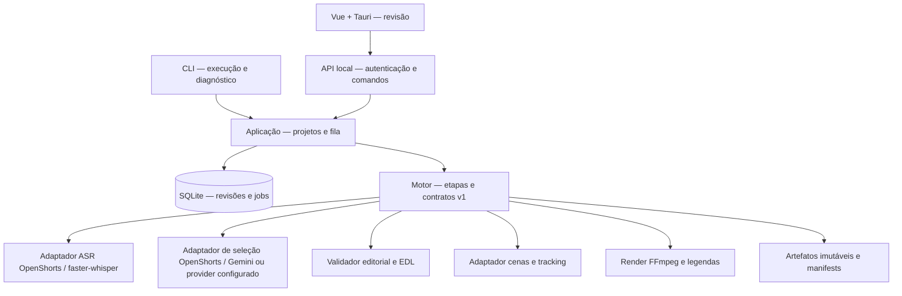

# Arquitetura proposta — adaptação incremental OpenShorts

Versão 0.1 aprovada pelo usuário em 12/10/2026, com OpenShorts + Gemini. O motor deve executar sem Vue, Tauri, dashboard React ou servidor HTTP. A PoC reutiliza módulos permissivos do snapshot fixado; não é um fork integral da plataforma comercial. O plano de implementação tem revisão separada.

Configuração escolhida pelo usuário: ASR/render no notebook e análise na API Gemini. O provider recebe texto da transcrição/contexto, sem upload de vídeo, áudio ou frames. Ollama permanece opcional para outras máquinas. Local-first descreve armazenamento e processamento de mídia; a seleção Gemini depende de conexão, com aviso claro antes de enviar texto. Offline continua disponível para revisão/render e seleção manual.

## Limites de responsabilidade

Interface: importa/revisa/exibe estado. Aplicação: comandos, persistência, fila e regras de permissão. Motor: transforma entradas em artefatos com interfaces estáveis. Render: consome EDL/crop/legendas já aprovados, sem escolher conteúdo. Nenhum provider conhece SQLite, UI ou estado global de outro job.

## Fronteira com a base

Preservar origem e commit em `vendor/openshorts/UPSTREAM.json` na implementação futura. Adapters fazem conversão segundos→microssegundos, palavras→IDs e saída upstream→contrato v1. Não espalhar formatos upstream pelo domínio.

| Módulo upstream | Uso proposto | Alteração necessária |
|---|---|---|
| `transcribe_backends.py`, `subtitles.py` | ASR e referência de legendas | Config por job, sem env global mutável; preservar texto bruto e versão |
| `clip_selection.py`, `llm_backend.py` | Janelas, snap, endpoint local | Índices/IDs e critérios editoriais; distinguir falta de candidatos de erro |
| `recut.py` | Matemática EDL/remap como referência | Contrato inteiro, intervalos protegidos e validação por revisão |
| `reframe_v2.py` e helpers de layout | Tracking após gate | Remover dependências desnecessárias; validar detector/CPU/licença |
| `main.py` | Comportamento de pipeline como referência | Extrair funções úteis; não importar plataforma toda no motor |
| `app.py`, dashboard | Apoio à investigação | Não serão a API/domínio do desktop sem revisão |
| `cloud/` | Fora da distribuição | Auditar imports e implementar requisitos locais sem copiar módulos comerciais |

Desligar recursos pagos não autoriza remover controles comerciais para oferecer esses recursos a terceiros. A proposta é distribuir somente o núcleo MIT e código novo local, sem `cloud/`.

## DAG e artefatos

`ingest → probe → audio → transcribe → analyze → select → edit_plan → track → captions → render → verify_export`.

`probe` e áudio alimentam cenas/silêncio; ASR alimenta análise, EDL e legendas. Tracking roda apenas nas cenas dos cortes selecionados, aproveitando detecção reutilizável por source. Metadados sugeridos dependem da transcrição e seleção; não bloqueiam render quando indisponíveis.

Cada estágio recebe `StageRequest` e retorna `StageResult` (contratos no documento de dados). Manifest contém versão, hash dos inputs, código/commit, config normalizada, modelo/digest, prompt/hash, tempos, avisos, inputs e outputs. Cache key = SHA-256 de JSON canônico desses dados. Datas e job_id não fazem parte do hash semântico. Artefatos são escritos como temporário, validados e promovidos por rename atômico no mesmo volume; só então transação SQLite marca etapa completa.

Trocar modelo ASR invalida transcrição e tudo abaixo. Trocar LLM/prompt invalida análise/seleção e descendentes. Editar texto de legenda invalida captions/render/verify, não ASR ou seleção. Ajustar crop invalida render/verify. Editar EDL invalida tracking temporal, legendas, render e QA; manter caches de deteção bruta da source. Não reutilizar arquivo apenas porque existe.

## Tempo e integridade

Tempo canônico em microssegundos inteiros, origem no primeiro instante decodificado normalizado; timebase e PTS originais preservados no probe/mapping. Adapter registra deslocamentos, trim e normalização de orientação. FPS usa fração racional, não estimativa inteira. Render pode produzir CFR 30 para entrega, sem perder correspondência até source.

EDL contém spans mantidos ordenados. Seleção inicial é contínua; únicas remoções automáticas internas permitidas são pausas comprovadas. Não concatenar frases distantes para criar um argumento novo. Montagem manual é uma revisão explicitamente marcada, com indicação da descontinuidade.

Remover pausa exige silêncio FFmpeg ≥1,2 s, ausência de fala VAD e ausência de sobreposição com palavras + margem de 150 ms por lado. Manter 150 ms nas duas bordas e pelo menos 300 ms de intervalo residual; reduzir somente o miolo excedente. Se esses intervalos entram em conflito ou ASR parece incompleto, manter a pausa e marcar revisão. Esses valores são presets propostos, sujeitos à escuta do corpus.

Modelo sugere temas, referências e word IDs; validação determinística rejeita IDs inexistentes, ordem inválida, durations, duplicações e corte de palavras. Continuidade de argumento, anáforas e ressalvas têm revisão editorial: não alegar prova automática de sentido.

## Tracking e legendas

Separar detecção, associação de tracks, escolha de principal e crop path. Uma face maior não garante que seja quem fala. No cenário inicial, rosto principal persistente; em ambiguidade, preservar quadro e sinalizar. Reset a cada scene cut; suavização dentro da cena com limites de aceleração, margem do rosto e coordenadas pares. Crop manual pertence à revisão.

Legendas derivam do mapa EDL, não de nova transcrição arbitrária. ASR original imutável; correções em `CaptionRevision`. Palavra que cruza uma borda é impedimento para corte automático, não motivo para encurtar o texto. Exportar word JSON, ASS dinâmico e SRT por grupos; SRT não conserva todos os efeitos de ASS. Revisão deve comparar alinhamento no render final.

## Execução, falha e cancelamento

Um worker pesado em subprocesso isolado por job; aplicação/API permanecem responsivas. Uma source por projeto na PoC, múltiplas no modelo de dados. Fila persistida, lease/heartbeat, lock por etapa/cache key e orçamento de CPU/RAM. Eventos numerados por job podem ser retomados via SSE. Progresso por estágio, sem estimativa fictícia de tempo.

Ao iniciar, jobs `running` sem worker vivo viram `interrupted`; retomada verifica manifests. Provider tem timeout e no máximo duas tentativas para transporte; JSON inválido admite uma solicitação de reparo e depois falha. Não reparar timestamps inventados em silêncio. Render com erro preserva log e EDL, elimina somente temporários próprios.

Cancelamento: solicitar, interromper cooperativamente, terminar árvore de subprocessos após grace period de 5 s; resultado não confirmado permanece parcial. Falta de disco e processo morto não geram saída “concluída”. Uma falha em corte de lote não cancela cortes independentes já concluídos.

## API e desktop futuro

FastAPI é um adapter: `/api/v1/projects`, `/sources`, `/jobs`, `/jobs/{id}/events`, `/jobs/{id}/cancel`, `/jobs/{id}/resume`, `/clips/{id}/revisions`, `/exports`. Commands mesmos na CLI. Token aleatório por sessão, port random loopback, Origin allowlist do Tauri e nenhuma CORS wildcard. Tauri gerencia lifecycle do sidecar; chave opcional remota no keyring, nunca no projeto.

Modo `offline` impede endpoints não loopback e qualquer provider remoto; modelos ausentes exigem provisionamento separado. Downloads/modelos/fontes têm origem, licença, digest e tamanho. Não ler cookies de navegador automaticamente. Não incluir updater que altere lock durante processamento.

## Decisões e riscos

OpenShorts escolhido. SQLite/WAL, subprocessos e artefatos são proposta. Sem Redis/Celery/Docker obrigatório. Stack Vue/Tauri pode ser mantida, pois não determina o motor. Riscos prioritários: imports comerciais, dependências pesadas, semântica de PT-BR, gaps ASR, drift de tempo e consumo de LLM CPU. Cada risco corresponde a um gate no roadmap; efeitos são posteriores.
