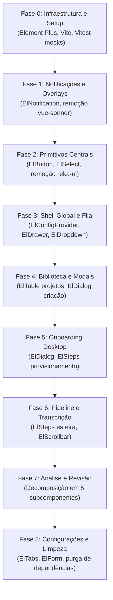

# AutoClip — Plano de Implementação Passo a Passo (Fases 0 a 8)

## Visão Geral da Execução

Este documento estabelece o roteiro de engenharia para migrar a camada visual do AutoClip para o **Element Plus** com risco zero de regressão no pipeline audiovisual desktop.

Cada tarefa possui um identificador único (`TASK-X.Y`), arquivos afetados, comandos de validação automatizada e estratégia de contingência/reversão.

---

## Fase 0: Infraestrutura, Setup de Dependências e Harness de Testes

### TASK-0.1: Instalação de Dependências e Configuração do Vite
- **Objetivo**: Adicionar `element-plus` e plugins de importação sob demanda sem inchar o bundle de produção.
- **Arquivos Afetados**:
  - `desktop/package.json`
  - `desktop/vite.config.ts`
- **Ações Técnicas**:
  1. Instalar `element-plus` e `unplugin-vue-components` / `unplugin-auto-import`.
  2. Configurar `vite.config.ts` com `ElementPlusResolver()` para componentes e diretivas.
- **Critérios de Aceite**:
  - `npm run build` compila sem erros de resolução de tipos ou módulos.
  - O bundle vendor não duplica estilos.
- **Comando de Teste**: `npm --prefix desktop run build`
- **Rollback**: Desfazer alterações no `package.json` e `vite.config.ts` via `git checkout`.

### TASK-0.2: Criação do Tema Dark e Mapeamento de Tokens
- **Objetivo**: Integrar os tokens semânticos do AutoClip (`tokens.css`) com as variáveis `--el-*` do Element Plus.
- **Arquivos Afetados**:
  - `desktop/src/element-theme.css` (novo)
  - `desktop/src/main.ts`
- **Ações Técnicas**:
  1. Criar `desktop/src/element-theme.css` importando `element-plus/theme-chalk/dark/css-vars.css` e remapeando `--el-color-primary`, `--el-bg-color`, `--el-border-color` para os tokens existentes.
  2. Importar `element-theme.css` em `main.ts` antes de `theme.css`.
- **Critérios de Aceite**:
  - Fundo permanece `#0E1013` e acento `#D97724`.
  - Nenhuma variável branca/clara padrão vaza no DOM.
- **Comando de Teste**: `npm --prefix desktop run dev` (inspeção visual rápida).
- **Rollback**: Excluir `desktop/src/element-theme.css` e reverter `main.ts`.

### TASK-0.3: Harness de Testes Vitest para Componentes Element Plus
- **Objetivo**: Evitar quebras nos testes unitários causadas por dependências de ambiente de navegador (como `ResizeObserver`, `matchMedia` e `MutationObserver`) requeridas por componentes complexos do Element Plus.
- **Arquivos Afetados**:
  - `desktop/src/test/setup.ts`
- **Ações Técnicas**:
  1. Adicionar polyfills seguros de `ResizeObserver`, `IntersectionObserver` e `window.matchMedia` no setup do Vitest.
  2. Mockar `ElNotification` para testes de integração de eventos.
- **Critérios de Aceite**:
  - Todos os 90 testes frontend existentes continuam passando com `npm --prefix desktop run test:unit`.
- **Comando de Teste**: `npm --prefix desktop run test:unit`
- **Rollback**: Reverter `desktop/src/test/setup.ts`.

---

## Fase 1: Sistema de Notificações e Camada de Overlays

### TASK-1.1: Adaptação de `notifications.ts` para `ElNotification`
- **Objetivo**: Substituir o backend do `vue-sonner` pelo `ElNotification` nativo do Element Plus, mantendo a assinatura exata da função `notify`.
- **Arquivos Afetados**:
  - `desktop/src/notifications.ts`
- **Ações Técnicas**:
  1. Manter a exportação `notify(type: 'success' | 'error' | 'info' | 'warning', title: string, message?: string)`.
  2. Implementar chamada a `ElNotification({ title, message, type, duration: 4000, position: 'top-right' })`.
  3. Mapear classes de estilo para usar a paleta dark do estúdio.
- **Critérios de Aceite**:
  - Zero alterações necessárias nas centenas de chamadas existentes `notify(...)` nos componentes.
  - Notificações aparecem com design dark e duração adequada.
- **Comando de Teste**: `npm --prefix desktop run test:unit notifications.test.ts`
- **Rollback**: Reverter `desktop/src/notifications.ts`.

### TASK-1.2: Eliminação do Hack de MutationObserver e Remoção do `AppToaster.vue`
- **Objetivo**: Eliminar a complexidade de observação de DOM e z-index hacks.
- **Arquivos Afetados**:
  - `desktop/src/components/AppToaster.vue` (remoção)
  - `desktop/src/App.vue`
- **Ações Técnicas**:
  1. Remover a tag `<AppToaster />` do template de `App.vue`.
  2. Excluir o arquivo `AppToaster.vue` e suas 60 linhas de observação de DOM e reparenting de dialog.
- **Critérios de Aceite**:
  - Nenhuma menção a `vue-sonner` em `App.vue`.
  - Notificações continuam visíveis sobre modais e drawers.
- **Comando de Teste**: `npm --prefix desktop run test:unit`
- **Rollback**: Restaurar `AppToaster.vue` e import em `App.vue`.

---

## Fase 2: Substituição de Primitivos Centrais e Purga do Reka UI

### TASK-2.1: Migração de `AppButton.vue` para `ElButton`
- **Objetivo**: Padronizar botões com suporte nativo a estados de loading, ícones, desabilitação e foco acessível.
- **Arquivos Afetados**:
  - `desktop/src/components/AppButton.vue`
- **Ações Técnicas**:
  1. Refatorar `AppButton.vue` para envelopar internamente `ElButton` repassando `props` (`variant -> type`, `loading`, `disabled`, `size`) e slots.
  2. Isso permite migração progressiva transparente sem quebrar chamadas legadas nos 15 componentes.
- **Critérios de Aceite**:
  - Componentes que usam `<AppButton>` continuam funcionando identicamente.
  - Spinner de carregamento padrão do Element Plus é exibido quando `loading === true`.
- **Comando de Teste**: `npm --prefix desktop run test:unit`
- **Rollback**: Restaurar implementação anterior de `AppButton.vue`.

### TASK-2.2: Migração de `AppSelect.vue` para `ElSelect` e Remoção de `reka-ui`
- **Objetivo**: Substituir o único uso de `reka-ui` no projeto por `ElSelect` + `ElOption`.
- **Arquivos Afetados**:
  - `desktop/src/components/AppSelect.vue`
  - `desktop/package.json` (remover `reka-ui`)
- **Ações Técnicas**:
  1. Reescrever `AppSelect.vue` utilizando `ElSelect` e `ElOption`.
  2. Remover `reka-ui` do `package.json`.
  3. Limpar classes específicas de Reka UI em `theme.css` (`.app-select-viewport`, `.app-select-scroll`).
- **Critérios de Aceite**:
  - Seletores de filtro na biblioteca e formulários de configuração funcionam perfeitamente.
  - O bundle não inclui mais nenhuma dependência `@reka-ui/*`.
- **Comando de Teste**: `npm --prefix desktop run build && npm --prefix desktop run test:unit`
- **Rollback**: Restaurar `AppSelect.vue` e `reka-ui` no `package.json`.

---

## Fase 3: Shell Global, Provedor de Configuração e Fila Global

### TASK-3.1: Envelopamento com `ElConfigProvider` e Localização pt-BR
- **Objetivo**: Prover contexto global de tema, z-index (2000) e idioma português para toda a árvore de componentes.
- **Arquivos Afetados**:
  - `desktop/src/App.vue`
- **Ações Técnicas**:
  1. Importar `ElConfigProvider` e `ptBr` de `element-plus/es/locale/lang/pt-br`.
  2. Envelopar o container raiz `
` com `<el-config-provider :locale="ptBr" size="default" :z-index="2000">`.
- **Critérios de Aceite**:
  - Qualquer componente do Element Plus renderizado no app fala pt-BR nativamente.
- **Comando de Teste**: `npm --prefix desktop run test:unit`
- **Rollback**: Reverter alterações em `App.vue`.

### TASK-3.2: Modernização do Header Global e Menu do Motor Local
- **Objetivo**: Substituir a tag pura `
` por `ElDropdown` para status da sessão do engine.
- **Arquivos Afetados**:
  - `desktop/src/App.vue`
- **Ações Técnicas**:
  1. Substituir o `
` do engine por `<el-dropdown trigger="click">`.
  2. Renderizar badge de status de conexão usando `<el-badge>` ou `<el-tag>`.
- **Critérios de Aceite**:
  - Menu fecha ao clicar fora sem bugs de estado embutidos no navegador.
  - Ação de reiniciar motor e métricas de porta são preservadas.
- **Comando de Teste**: Teste manual no dev server + `test:unit App.test.ts`.
- **Rollback**: Reverter `<el-dropdown>` para `
` em `App.vue`.

### TASK-3.3: Migração da Fila Global para `ElDrawer`
- **Objetivo**: Transformar o painel de fila lateral em uma gaveta moderna e deslizante.
- **Arquivos Afetados**:
  - `desktop/src/components/GlobalQueueDrawer.vue` (novo ou adaptado)
  - `desktop/src/App.vue`
- **Ações Técnicas**:
  1. Substituir a sobreposição manual por `<el-drawer v-model="isQueueOpen" title="Fila Global de Processamento" size="420px" direction="rtl">`.
  2. Renderizar lista de tarefas ativas com progresso visual via `ElProgress`.
- **Critérios de Aceite**:
  - Gaveta desliza suavemente à direita e pode ser fechada com a tecla ESC ou clique no backdrop.
- **Comando de Teste**: `npm --prefix desktop run test:unit`
- **Rollback**: Reverter para o banner/sidebar fixo anterior.

---

## Fase 4: Biblioteca de Projetos e Modal de Criação

### TASK-4.1: Tabela da Biblioteca com `ElTable`
- **Objetivo**: Substituir a tabela HTML pura por `ElTable`, ganhando ordenação nativa, estados vazios acessíveis e layouts fluidos.
- **Arquivos Afetados**:
  - `desktop/src/components/LibraryView.vue`
- **Ações Técnicas**:
  1. Migrar colunas para `ElTableColumn` (Thumbnail, Título/Metadados, Status, Atualização, Ações).
  2. Utilizar `ElTag` para os status de projeto (`analyzed`, `needs_review`, `ready`).
  3. Integrar campo de busca com `ElInput` e filtros com `ElSelect`.
- **Critérios de Aceite**:
  - Clique na linha continua abrindo o projeto selecionado.
  - Ordenação por data/título funciona sem perda de performance com 100+ projetos.
- **Comando de Teste**: `npm --prefix desktop run test:unit LibraryView.test.ts`
- **Rollback**: Reverter `LibraryView.vue`.

### TASK-4.2: Modal de Criação com `ElDialog` e `ElForm`
- **Objetivo**: Substituir `<dialog class="modal">` por `ElDialog` com validação síncrona via `ElForm`.
- **Arquivos Afetados**:
  - `desktop/src/components/ProjectModal.vue`
- **Ações Técnicas**:
  1. Substituir `<dialog>` por `<el-dialog v-model="visible" title="Novo Projeto" width="600px">`.
  2. Implementar `ElForm` com regras de validação para URL do YouTube e seleção de arquivo local.
  3. **Preservar Contrato Desktop**: O seletor de arquivo continua invocando `api.pick('video')` nativo. `ElUpload` não realiza POST HTTP.
- **Critérios de Aceite**:
  - Submissão só é habilitada quando uma fonte válida (arquivo ou URL) é informada.
  - Janela nativa de seleção de arquivo (`rfd`) abre sem erros no Windows.
- **Comando de Teste**: `npm --prefix desktop run test:unit ProjectModal.test.ts`
- **Rollback**: Reverter `ProjectModal.vue`.

---

## Fase 5: Modal de Onboarding Desktop e Provisionamento

### TASK-5.1: Refatoração do `OnboardingModal.vue` com `ElSteps` e `ElProgress`
- **Objetivo**: Oferecer feedback visual de alta qualidade para o download de modelos de IA (Faster-Whisper, PyAnnote) e ferramentas locais (FFmpeg).
- **Arquivos Afetados**:
  - `desktop/src/components/OnboardingModal.vue`
- **Ações Técnicas**:
  1. Migrar a barra de etapas para `<el-steps :active="currentStep" finish-status="success">`.
  2. Implementar `<el-progress :percentage="downloadProgress" :status="downloadStatus">` com animação de barra ativa durante downloads de centenas de megabytes.
  3. Exibir cartões de verificação com `<el-card>` e alertas de erro com `<el-alert>`.
- **Critérios de Aceite**:
  - Indicador de porcentagem e velocidade de download atualizam reativamente a cada chunk recebido do backend.
  - Modal fecha limpo após sucesso sem congelar a interface.
- **Comando de Teste**: `npm --prefix desktop run test:unit OnboardingModal.test.ts`
- **Rollback**: Reverter `OnboardingModal.vue`.

---

## Fase 6: Pipeline de Preparação e Visualizador de Transcrição

### TASK-6.1: Esteira de Preparação com `ElSteps` e Detalhe de Logs
- **Objetivo**: Exibir o pipeline de 5 estágios (Download, Áudio, Transcrição, Detecção de Rosto, Análise) de maneira clara e com visualização de logs retrátil.
- **Arquivos Afetados**:
  - `desktop/src/components/PipelinePrep.vue`
- **Ações Técnicas**:
  1. Renderizar etapas através de `ElSteps` vertical ou horizontal com ícones semânticos de progresso.
  2. Adicionar `<el-collapse>` para visualização sob demanda dos logs de subprocessos do FFmpeg e Whisper.
- **Critérios de Aceite**:
  - Botão de cancelamento de pipeline emite evento correto para o backend FastAPI.
  - Falha em qualquer etapa marca o passo como `error` e destaca a mensagem diagnóstica.
- **Comando de Teste**: `npm --prefix desktop run test:unit PipelinePrep.test.ts`
- **Rollback**: Reverter `PipelinePrep.vue`.

### TASK-6.2: Transcrição Sincronizada com `ElScrollbar`
- **Objetivo**: Renderizar centenas de segmentos de legenda com busca rápida e rolagem suave sem recálculos lentos de layout.
- **Arquivos Afetados**:
  - `desktop/src/components/TranscriptView.vue`
- **Ações Técnicas**:
  1. Envelopar lista de segmentos em `<el-scrollbar ref="transcriptScrollbar">`.
  2. Adicionar filtro por palavra-chave usando `<el-input :icon="Search" clearable>`.
  3. Manter sincronização bidirecional de clique no timestamp com o `<video>` player nativo.
- **Critérios de Aceite**:
  - Clique no segmento salta o vídeo para o ponto exato.
  - Reprodução contínua faz scroll automático para o segmento falado no momento.
- **Comando de Teste**: `npm --prefix desktop run test:unit TranscriptView.test.ts`
- **Rollback**: Reverter `TranscriptView.vue`.

---

## Fase 7: Decomposição e Redesign dos Monólitos (Análise e Revisão)

### TASK-7.1: Decomposição Arquitetural de `AnalysisPanel.vue`
- **Objetivo**: Quebrar o arquivo monolítico de 1.579 linhas em 5 subcomponentes coesos e manuteníveis.
- **Arquivos Criados/Afetados**:
  - `desktop/src/components/analysis/AnalysisTopicNav.vue` (novo)
  - `desktop/src/components/analysis/AnalysisCandidateList.vue` (novo)
  - `desktop/src/components/analysis/AnalysisCandidateCard.vue` (novo)
  - `desktop/src/components/analysis/AnalysisInspector.vue` (novo)
  - `desktop/src/components/analysis/AnalysisSummaryBar.vue` (novo)
  - `desktop/src/components/AnalysisPanel.vue` (orquestrador leve)
- **Ações Técnicas**:
  1. `AnalysisTopicNav`: Navegação por tópicos usando `ElMenu` vertical ou botões com tags de contagem.
  2. `AnalysisCandidateList`: Grid responsivo envelopado em `ElScrollbar`.
  3. `AnalysisCandidateCard`: Card com `ElCard`, nota de virilidade via `ElRate`/`ElTag`, badges temáticos e seleção de checkbox.
  4. `AnalysisInspector`: Drawer ou painel direito com visualização de raciocínio da IA, transcrição do trecho e player 16:9 de pré-visualização.
  5. `AnalysisSummaryBar`: Barra inferior com `ElButton` em lote e contadores reativos.
- **Critérios de Aceite**:
  - `AnalysisPanel.vue` orquestrador fica abaixo de 250 linhas.
  - Todas as funções de aprovação/rejeição e filtro por modelo (Gemini / OpenRouter) funcionam identicamente.
- **Comando de Teste**: `npm --prefix desktop run test:unit AnalysisPanel.test.ts`
- **Rollback**: Manter `AnalysisPanel.vue` original e remover subpasta `analysis/`.

### TASK-7.2: Redesign da Tela de Revisão (`ReviewPanel.vue`)
- **Objetivo**: Otimizar a revisão de cortes prontos com seleção em lote, status visuais ricos e player vertical 9:16 dedicado.
- **Arquivos Afetados**:
  - `desktop/src/components/ReviewPanel.vue`
- **Ações Técnicas**:
  1. Renderizar tabela de cortes aprovados via `ElTable` com suporte a seleção por checkbox (`type="selection"`).
  2. Implementar barra flutuante de ações em lote ("Exportar Selecionados", "Excluir Selecionados") via `ElCard`.
  3. Integrar player de vídeo 9:16 na coluna direita com controle de reprodução instantânea.
- **Critérios de Aceite**:
  - Seleção em lote permite exportar múltiplos arquivos MP4 de uma só vez.
  - Reprodução do vídeo vertical respeita as dimensões 9:16 sem distorção.
- **Comando de Teste**: `npm --prefix desktop run test:unit ReviewPanel.test.ts`
- **Rollback**: Reverter `ReviewPanel.vue`.

---

## Fase 8: Painel de Configurações e Purga Final de Dependências

### TASK-8.1: Reorganização de `SettingsPanel.vue` em Abas e Subformulários
- **Objetivo**: Reduzir as 1.134 linhas de configurações em abas lógicas (`ElTabs`) com validação reativa (`ElForm`).
- **Arquivos Afetados**:
  - `desktop/src/components/SettingsPanel.vue`
- **Ações Técnicas**:
  1. Dividir em 3 abas lógicas: "Provedores de IA" (Gemini/OpenRouter), "Processamento de Vídeo" (GPU/Resolução/Bitrate) e "Armazenamento & Sistema" (Caminhos/Logs).
  2. Utilizar `ElSwitch` para toggles (aceleração de hardware, modo debug).
  3. Utilizar `ElInputNumber` para limites numéricos (duração mínima/máxima de cortes, taxa de quadros).
  4. Utilizar `ElInput` com `show-password` para chaves de API.
- **Critérios de Aceite**:
  - Salvamento de configurações persiste no backend via `PUT /api/settings`.
  - Teste de conexão de API key fornece feedback visual instantâneo com `ElTag` ou `notify()`.
- **Comando de Teste**: `npm --prefix desktop run test:unit SettingsPanel.test.ts`
- **Rollback**: Reverter `SettingsPanel.vue`.

### TASK-8.2: Limpeza Final de Código Morto e Desinstalação de Pacotes Obsoletos
- **Objetivo**: Garantir que o repositório fique livre de código residual e dependências desnecessárias.
- **Arquivos Afetados**:
  - `desktop/package.json`
  - `desktop/src/theme.css`
  - `desktop/src/components/AppSelect.vue` / `desktop/src/components/AppButton.vue` (remover wrappers intermediários se todos os componentes importarem Element Plus diretamente)
- **Ações Técnicas**:
  1. Executar `npm uninstall reka-ui vue-sonner`.
  2. Remover blocos de CSS legados em `theme.css` que foram absorvidos pelo Element Plus.
  3. Rodar `vue-tsc --noEmit` e `eslint` para certificar integridade estática total.
- **Critérios de Aceite**:
  - `npm ls reka-ui` e `npm ls vue-sonner` retornam vazio.
  - Build de produção (`npm run build`) gera bundle limpo e sem warnings.
  - Tamanho final do pacote do aplicativo desktop (`.exe`) dentro da margem esperada.
- **Comando de Teste**:
  - `npm --prefix desktop run typecheck`
  - `npm --prefix desktop run test:unit`
  - `npm --prefix desktop run build`
- **Rollback**: Reinstalar pacotes via `npm install`.
