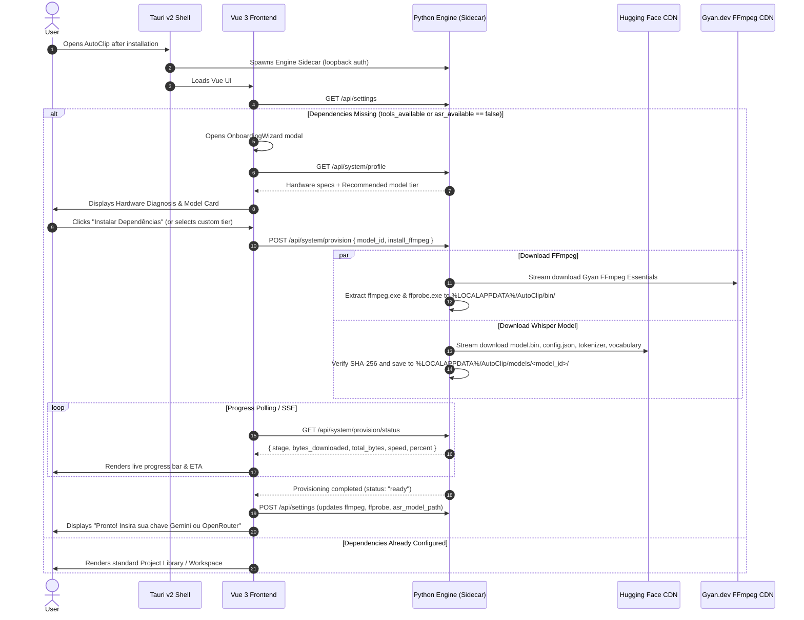

# Design Specification: Desktop App Distribution & Smart Hardware Onboarding

- **Date:** 2026-10-13
- **Status:** Proposed (Ready for Review)
- **Target Branch:** `poc-openshorts-gemini`
- **Authors:** Antigravity Team & Matheus

---

## 1. Executive Summary & Goals

Transform AutoClip from a developer checkout into a commercial-grade, standalone Windows desktop application (`AutoClip-Setup.exe`). The app must be zero-configuration for end users:

1. **Standalone Windows Installer:** Distributed via Tauri v2 (NSIS installer), bundling the Vue 3 frontend and Python engine as a sidecar process. No pre-installed Python, Node, Git, or developer tools required.
2. **Smart Hardware Profiling:** On first launch, the app scans the system (CPU cores, RAM total/available, NVIDIA GPU/VRAM) in <100ms.
3. **Adaptive Whisper Recommendation:** Automatically suggests the optimal Whisper model tier (`base`, `small`, or `large-v3-turbo`) matching the hardware capabilities, while letting the user customize if desired.
4. **1-Click Automated Dependency Provisioning:** Downloads FFmpeg/ffprobe and the chosen Whisper model directly into `%LOCALAPPDATA%/AutoClip/` with a real-time graphical progress bar in the Vue UI.
5. **Seamless Handoff:** Once dependencies are verified, transitions directly to the API key screen (Google Gemini or OpenRouter), allowing the user to begin editing immediately.

---

## 2. Architecture & System Flow



---

## 3. Hardware Profiling & Recommendation Matrix

### 3.1 Profiler (`engine/system/profiler.py`)
Collects hardware metrics without blocking:
- **CPU:** Physical and logical core count (`psutil.cpu_count`).
- **RAM:** Total and available memory in gigabytes (`psutil.virtual_memory()`).
- **GPU:** Probes for dedicated NVIDIA GPUs via driver WMI queries or `ctranslate2.get_cuda_device_count()`, extracting GPU name and VRAM.

### 3.2 Model Recommendation Rules

| Tier | Hardware Criteria | Whisper Model | Weights Size | Memory Footprint | Runtime Mode | Expected PT-BR Accuracy |
| :--- | :--- | :--- | :--- | :--- | :--- | :--- |
| **Tier 1 (Leve)** | CPU ≤ 4 cores **ou** RAM < 8 GB | `Systran/faster-whisper-base` | ~140 MB | ~1 GB | CPU (`int8`) | Boa para falas claras |
| **Tier 2 (Equilibrado)** | CPU ≥ 6 cores **e** RAM ≥ 8 GB | `Systran/faster-whisper-small` | ~460 MB | ~2 GB | CPU (`int8`) | Alta (padrão atual) |
| **Tier 3 (Alta Performance)** | RAM ≥ 16 GB **ou** GPU NVIDIA ≥ 4GB VRAM | `Systran/faster-whisper-large-v3-turbo` | ~800 MB | ~3.5 GB | CPU ou CUDA (`float16`) | Excelente (estado da arte) |

---

## 4. Automated Dependency Provisioner (`engine/system/provisioner.py`)

### 4.1 Storage Layout
All downloaded tools and models reside in the user's local application data folder, separated from git:
```text
%LOCALAPPDATA%/AutoClip/
├── bin/
│   ├── ffmpeg.exe
│   └── ffprobe.exe
├── models/
│   ├── whisper-base/
│   ├── whisper-small/
│   └── whisper-large-v3-turbo/
│       ├── model.bin
│       ├── config.json
│       ├── tokenizer.json
│       └── vocabulary.txt
└── projects/
```

### 4.2 FFmpeg Automated Provisioning
1. If `ffmpeg.exe` and `ffprobe.exe` are already in `PATH` or WinGet, the engine uses them directly (`tools_available: true`).
2. If missing, downloads the official Gyan FFmpeg Essentials release (`ffmpeg-release-essentials.zip`).
3. Extracts only `ffmpeg.exe` and `ffprobe.exe` directly to `%LOCALAPPDATA%/AutoClip/bin/`.
4. Deletes the zip file after extraction.

### 4.3 Whisper Weights Streaming
1. Targets official CTranslate2 Hugging Face repositories:
   - `https://huggingface.co/Systran/faster-whisper-base/resolve/main/`
   - `https://huggingface.co/Systran/faster-whisper-small/resolve/main/`
   - `https://huggingface.co/Systran/faster-whisper-large-v3-turbo/resolve/main/`
2. Downloads files (`config.json`, `tokenizer.json`, `vocabulary.txt`, `model.bin`) using streaming HTTP chunks.
3. Computes progress events emitted via `/api/system/provision/status`.

---

## 5. Frontend UX: Onboarding Wizard (`OnboardingModal.vue`)

### Step 1: Diagnóstico de Hardware & Escolha do Modelo
- Card com o resumo do computador:
  - Ex: *"Intel Core i7 (12 núcleos) · 16 GB RAM · NVIDIA GeForce RTX 3060 (6 GB VRAM)"*.
- Badge de recomendação em destaque:
  - *"⭐ Tier 3: Whisper Large v3 Turbo (Recomendado para o seu setup)"*.
- Opção para alternar entre os tiers (Leve, Equilibrado, Turbo) com descrição de tamanho em MB e tempo estimado.
- Checkbox opcional de FFmpeg (marcado automaticamente se não detectado no sistema).

### Step 2: Download com Progresso Visual
- Barra de progresso animada com porcentagem, velocidade em MB/s e tempo restante.
- Lista de itens em andamento:
  - `[✓] FFmpeg & ffprobe multimídia`
  - `[>] Modelo Whisper (model.bin: 450 MB / 800 MB)`
- Botão de cancelamento seguro com limpeza de arquivos temporários.

### Step 3: Conclusão & Configuração de API
- Transição suave: *"Tudo pronto! Seu computador está configurado para editar cortes 100% offline."*
- Formulário direto para inserir a chave de API do Gemini ou OpenRouter.
- Botão "Abrir AutoClip e Começar".

---

## 6. Packaging & Tauri Sidecar Architecture

1. **Sidecar Compilado:**
   - Script `scripts/build_engine_sidecar.py` usando `pyinstaller` para gerar `engine-bundle/autoclip-engine.exe`.
   - Inclui dependências estáticas de áudio/vídeo (`PyAV`, `mediapipe`, `faster-whisper`, `fastapi`, `uvicorn`).
2. **Tauri v2 Config (`desktop/src-tauri/tauri.conf.json`):**
   - Ativa `bundle.active = true` com target `nsis`.
   - Registra o executável do engine em `externalBin`: `["bin/autoclip-engine"]`.
3. **Inno Setup / NSIS Installer:**
   - Gera um instalador leve `AutoClip-Setup-v0.1.0.exe`.

---

## 7. Verification & Testing Strategy

1. **Unit Tests (Backend):**
   - `tests/unit/test_profiler.py`: Testa detecção de hardware e regras da matriz de recomendação para diferentes perfis de CPU/RAM/GPU.
   - `tests/unit/test_provisioner.py`: Testa streaming de downloads, extração segura de zip e tratamento de falhas de conexão.
   - `tests/api/test_system_endpoints.py`: Valida `/api/system/profile` e `/api/system/provision/status`.
2. **Component Tests (Frontend):**
   - `desktop/tests/onboarding-modal.test.ts`: Testa exibição do wizard quando dependências estão ausentes, seleção de tier e avanço para tela de chaves.
3. **E2E & Build Verification:**
   - Executar `npm test -- --run` no frontend.
   - Executar `pytest` no backend.
   - Validar compilação do bundle via `npm run build`.
