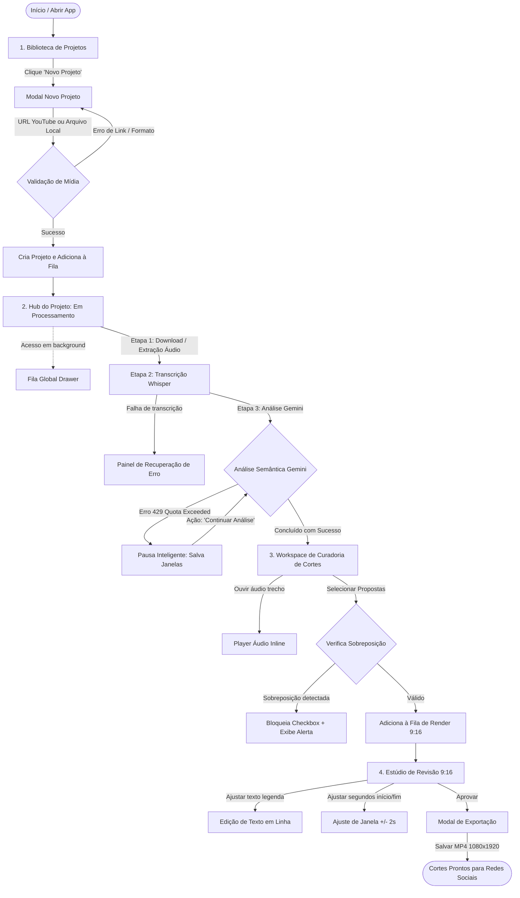

# 04. Arquitetura de Informação, Modelos de Navegação e Wireflows

## 1. Avaliação de Modelos Estruturais e Alternativas

Para definir a melhor arquitetura de informação (IA) do AutoClip, foram avaliadas três alternativas estruturais:

| Modelo Estrutural | Descrição | Prós | Contras | Veredito |
| :--- | :--- | :--- | :--- | :--- |
| **Opção 1: Multi-Tab Editor (Estado Atual)** | Abas paralelas fixas no topo do projeto: *Preparação*, *Transcrição*, *Análise*, *Cortes*. | Fácil de implementar tecnicamente como componentes isolados. | Cria desconexão mental grave; esconde a ordem natural das etapas; o usuário não sabe se precisa abrir a Transcrição antes da Análise; gera rolagem dupla e conflito de altura 9:16. | **Rejeitado.** Causa sobrecarga e perda de contexto. |
| **Opção 2: Wizard Linear Rígido (Passo a Passo Estrito)** | Telas sequenciais com apenas botões *"Avançar"* e *"Voltar"*. | Extrema simplicidade para iniciantes; reduz escolhas acidentais. | Inflexível para o fluxo de revisão; impede voltar rapidamente para comparar outro tema sem refazer etapas; engessa criadores frequentes. | **Rejeitado.** Incompatível com o modelo de exploração editorial. |
| **Opção 3: Hub-and-Spoke com Esteira Semântica e Espaços Focados (Recomendado)** | A visão geral do projeto funciona como um **Centro de Controle (Task Hub)** com status claro das etapas (Importação -> Transcrição -> Análise -> Curadoria -> Revisão/Exportação). Ações chave abrem **Espaços de Trabalho Dedicados** (Workspace de Curadoria e Estúdio de Revisão 9:16) com navegação fluida de retorno. | Elimina ruído das abas desnecessárias; guia o usuário com clareza (princípio GOV.UK Task List); libera 100% da área útil da tela de 1366×768 para o player vertical e cards de texto; preserva controle total. | Exige design de transição bem estruturado e breadcrumb de retorno claro. | **ESCOLHIDO (Recomendado).** Máxima aderência aos objetivos de produto e usabilidade. |

---

## 2. Mapa Geral da Arquitetura de Informação (Árvore de Telas)

```text
[AutoClip Desktop App]
│
├── 1. BIBLIOTECA DE PROJETOS (Tela Inicial)
│    ├── Header Global: Logo, Status do Motor Local, Botão Fila Global (Badge com contagem), Configurações, Botão "Novo Projeto"
│    ├── Busca e Filtros de Projetos (Todos, Em Andamento, Concluídos)
│    ├── Grid/Lista de Projetos Recentes (Título, Thumbnail, Duração, Status, Total de Cortes)
│    └── Modal Novo Projeto (URL YouTube / Arquivo Local)
│
├── 2. FILA GLOBAL DE TAREFAS (Drawer/Modal Acessível Globalmente)
│    ├── Lista agregada de jobs em execução e pendentes de todos os projetos
│    ├── Barra de progresso percentual e etapa técnica atual
│    └── Ações: Pausar, Cancelar job, "Abrir Projeto"
│
├── 3. HUB DO PROJETO (Visão Geral & Central de Etapas)
│    ├── Cabeçalho do Projeto: Título editável, Duração original, Thumbnail, Ações rápidas
│    ├── Esteira de Progresso Semântico (Importação ✓ -> Transcrição ✓ -> Análise Temática ✓ -> Cortes Prontos)
│    ├── Bloco de Ação Principal (Call-to-Action contextual conforme o estágio atual)
│    ├── Gaveta de Transcrição Completa (Acessível sob demanda, sem poluir a visão inicial)
│    └── Histórico de Exportações do Projeto
│
├── 4. ESPAÇO DE CURADORIA E PROPOSTAS (Focado em Seleção de Conteúdo)
│    ├── Filtro/Lista de Temas Identificados (Assuntos principais)
│    ├── Grid/Lista de Propostas de Cortes
│    │    ├── Título, Gancho (Hook), Duração, Justificativa da IA
│    │    ├── Player de Áudio Rápido (Ouvir trecho sem renderizar vídeo)
│    │    ├── Indicador de Conflito de Tempo / Proteção de Sobreposição
│    │    └── Seleção para Geração de Prévias
│    └── Barra de Ação Flutuante: "Gerar [N] Prévias Verticais"
│
├── 5. ESTÚDIO DE REVISÃO E PRÉVIA VERTICAL 9:16 (Focado em Entrega)
│    ├── Lista Lateral de Cortes Gerados (Miniaturas 9:16, Título, Duração)
│    ├── Player Vertical Central (Proporção 9:16 calibrada, controles acessíveis)
│    ├── Painel Lateral de Ajustes:
│    │    ├── Ajuste Fino de Início e Término (Sliders/Trimmers de precisão)
│    │    ├── Editor de Legendas (Correção rápida de texto)
│    │    └── Estilo Visual (Posição e destaque da legenda)
│    └── Botões de Ação: "Exportar Este Corte" / "Exportar Todos os Prontos"
│
└── 6. CONFIGURAÇÕES GERAIS (Modal com Abas Limpas)
     ├── Geral & Hardware (Desempenho CPU/GPU, pastas de salvamento)
     ├── Chaves & Serviços (Google Gemini API Key, status de conexão)
     └── Parâmetros de Cortes (Sensibilidade de silêncio, duração padrão sugerida)
```

---

## 3. Diagrama de Wireflows e Estados do Sistema (Mermaid)



---

## 4. Matriz de Transições e Regras de Redirecionamento

1. **Estado "Novo / Importando":** Ao entrar em um projeto recém-criado, o usuário vê o Hub com a esteira animada e progresso real. O botão de "Curadoria" fica travado com texto indicativo (*"Aguardando análise semântica..."*).
2. **Estado "Analisado / Sem Prévias":** O Hub exibe banner de destaque convidando o usuário: *"Análise concluída! 8 propostas de cortes identificadas"*, com botão de ação direta *"Abrir Curadoria"*.
3. **Estado "Prévias Geradas":** O Hub atualiza automaticamente a esteira para *"3 cortes gerados prontos para revisão"*, com atalho direto para o *"Estúdio de Revisão 9:16"*.
4. **Persistência de Rota:** Se o usuário fechar o aplicativo no meio da revisão de um corte, ao reabrir o projeto ele retorna exatamente para a tela e corte onde parou.
