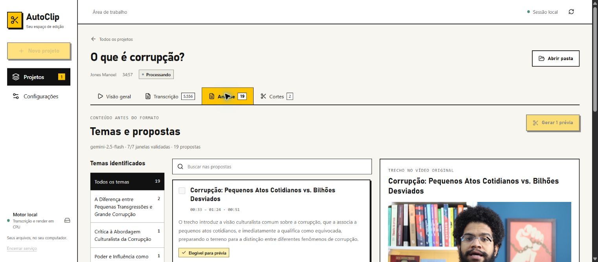

# Análise, fila de prévias e UI brutalista — 12/10/2026

## Entrega

- Nova aba Análise: temas, busca, propostas, justificativas, flags, duração medida e reprodução do original/contexto sem renderizar.
- Seleção persistente vinculada ao hash da análise. Geração manual aceita mais de três propostas e conserva variantes sobrepostas com aviso.
- Dados parciais vêm de snapshots atômicos de janelas validadas; uma análise nova não mistura o resultado anterior.
- Visão geral conserva divisão 50/50 e distingue preparação automática, escolha, geração, revisão e exportação. Resumos longos ficam na Análise.
- Fila por corte com codificação mensurável, verificação separada, publicação imediata de prévias prontas e retomada apenas dos pendentes.
- Revisões antigas e aprovações preservadas. Receita de apresentação alterada cria nova revisão. Decisões não regravam o índice enquanto o worker publica cortes.
- Tema claro global inspirado nas referências: preto/amarelo, bordas, controles quadrados, títulos fortes, foco contrastante. Biblioteca, projeto, revisão, configurações e diálogos usam o mesmo sistema.
- Novas renderizações são um recorte central estático 1080×1920 com legendas gravadas, sem blur ou vídeo horizontal sobreposto. Dois threads de CPU em decoder/encoder/filtros.

## Evidência automatizada

- Suíte completa: **124 passed, 1 skipped**. O teste remoto opt-in do provedor permaneceu desativado.
- Frontend: **38 passed**; `vue-tsc` e build Vite concluídos.
- Após limitar threads: **4 passed** nos testes específicos de comando, pixels do centro, legendas, progresso real e preservação de revisão aprovada.
- MP4 sintético validado em 1080×1920. Pixels nas bordas/middle pertencem à faixa central verde; as faixas laterais vermelha/azul não voltam por overlay. Pixels claros da legenda aparecem na região inferior. QA audiovisual técnica passou.
- Progresso só publica `ready` após QA; a revisão já está em `project.json` quando o callback de prontidão é emitido.
- Retry de lote com item pronto/falhado executa somente o falhado e conserva a escolha editorial original.
- Nova receita de render preserva fingerprint e exportabilidade da revisão previamente aprovada.

## Revisão independente e regressões

Três achados corrigidos: disputa de gravação de `project.json` ao aprovar durante renderização; retry substituindo seleção original; passagem parcial→completa limpando tópico/detalhe. Os dois testes backend reproduziram o erro e passaram após o reparo. Teste frontend cobre tópico/detalhe e seleção preservados.

Inspeção visual também revelou resposta atrasada reabrindo projeto após navegar para Configurações. Navegação agora invalida solicitações anteriores; regressão passou.

A prévia real revelou um conflito Windows de compartilhamento em `progress.json`: `os.replace` recebeu WinError 5 enquanto a UI consultava o arquivo. Traceback local identificou a causa; escrita atômica agora repete brevemente WinError 5/32, de modo limitado. Regressão falhou antes e passou depois. Diagnósticos ficam locais e ignorados pelo Git.

## Dados reais e UI

Leitura da análise salva de “O que é corrupção?”: **7 janelas, 19 propostas, 18 elegíveis, 12 grupos conservadores de temas**. A proposta de 13 segundos é bloqueada e o motivo explica a faixa mínima/máxima. Nenhuma nova chamada Gemini foi realizada.

Inspecionados 1440×900, 1366×768 e 390×844. Sem overflow horizontal do documento. Seleção permaneceu ao atualizar; navegação por seta nas abas levou à área correta. Em 390 px, as quatro abas foram ajustadas para permanecer visíveis, sem depender de rolagem horizontal. Preview original, busca e leitura continuam disponíveis durante geração.

A renderização real ativa foi preservada na atualização do serviço e concluiu: **126,46 segundos**, revisão `1545fcaa-4b92-4a28-a794-81df170e2a45`, **QA técnica aprovada**, recorte central 1080×1920 e legenda gravada. O frame do MP4 foi extraído e inspecionado: não há blur artificial ou sobreposição horizontal. São três prévias visíveis; as anteriores e a lixeira permanecem preservadas. A prévia nova aguarda revisão editorial humana; nenhuma aprovação foi criada pelo agente. Evidência: `real-center-crop-validation.json` e `real-center-crop-frame.jpg`.

## Contratos e limites

Detalhes: `docs/analysis-workspace-contracts.md` e `docs/frontend-runbook.md`. Não há acompanhamento facial nesta entrega: o recorte é central estático. Agrupamento por rótulo equivalente conserva temas semelhantes com nomes diferentes. Percentual mede codificação, não qualidade editorial. A autorização humana de exportação continua vinculada à revisão.

[Frame da prévia real 9:16 com legenda](real-center-crop-frame.jpg)
